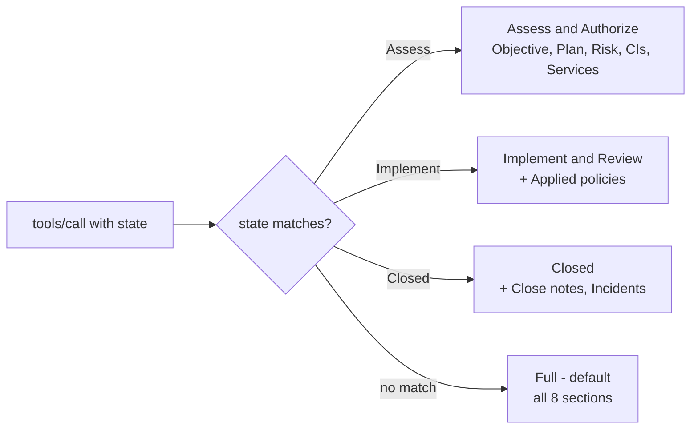
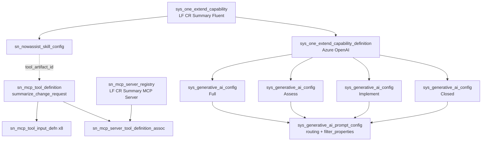

# CR Summary Fluent

Now Assist skill that summarizes a change request from **plain text inputs** so it can be served as an **MCP tool**.

Built with the ServiceNow Fluent SDK (`NowAssistSkillConfig`). No direct LLM calls. All inputs are plain strings so an external MCP client can supply them without a ServiceNow session.

> Instance hostname and app-specific sys_ids are redacted. Replace `YOUR_INSTANCE`
> and the `<...>` placeholders with your own values. OOB platform sys_ids are left
> intact — they are the same on every instance.

---

## 1. Identity / record map

| Thing | Value |
|---|---|
| App name | LF CR Summary Fluent |
| Scope | `x_snc_lf_cr_summ_0` |
| App sys_id (`sys_scope`) | `<APP_SYS_ID>` |
| Skill (`sys_one_extend_capability`) | `<CAPABILITY_ID>` |
| Skill config (`sn_nowassist_skill_config`) | `<SKILL_CONFIG_ID>` |
| Capability definition (`sys_one_extend_capability_definition`) | `<DEFINITION_ID>` |
| Prompt: Full (`sys_generative_ai_config`) | `<PROMPT_FULL_ID>` |
| Prompt: Assess and Authorize | `<PROMPT_ASSESS_ID>` |
| Prompt: Implement and Review | `<PROMPT_IMPLEMENT_ID>` |
| Prompt: Closed | `<PROMPT_CLOSED_ID>` |
| MCP tool (`sn_mcp_tool_definition`) | `<MCP_TOOL_ID>` |
| MCP server (`sn_mcp_server_registry`) | `<MCP_SERVER_ID>` |
| Skill family | `Other` (OOB `a5efaf1c93764210aa5730f16489186d`) |

**Skill Kit URL**
```
https://YOUR_INSTANCE.service-now.com/now/now-assist-skillkit/skill/<CAPABILITY_ID>/params/prompt-id/<PROMPT_FULL_ID>/config-id/<SKILL_CONFIG_ID>
```

**MCP server endpoint**
```
https://YOUR_INSTANCE.service-now.com/sncapps/mcp-server/mcp/x_snc_lf_cr_summ_0_lf_cr_summary
```

---

## 2. Design

### Why plain-text inputs

An MCP client has no ServiceNow session and no record context, so it cannot hand the skill a record. All six inputs are plain strings the caller assembles and sends.

**This is not a platform restriction.** A `sys_id` input does not block anything — the OOB Incident and Case summarization skills both have one and are available as MCP tools.

What actually controls availability in the MCP tool picker is three gates, in `AISkillToolCategoryImp.getArtifacts()`:

1. `workflow !== 'Platform'`
2. `active === 'true'` — derived from `state=1` (published), **not** the `active` column
3. not listed in `sn_mcp_server_skill_config_exclude`

That exclude table is a hand-curated block list of ~27 published, active skills. Every one of them shares the OOB record-summarization input signature:

```
short_description, other_fields(json_object), state, activities(json_array),
tablename, sysid, priority, sections, description, relatedlists_data(json_object)
```

Those inputs are filled in by the platform — the form passes `sysid` + `tablename`, and ServiceNow fetches the record and packs the JSON blobs. An external client cannot produce them. **The gate exists so you can't build a tool that fails every call.**

ServiceNow exempted two of that family instead of blocking them: Incident and Case summarization. Their MCP tools take `incidentNumber` / `caseNumber` + `tablename`, and the tool layer resolves number → sys_id server-side via `_resolveInputs` (`input.resolver.table` / `.field`).

### Design verdict

Custom skill: correct. Reusing the OOB CR prompt wording: correct — it is tested copy, no reason to rewrite.

The one trade-off made here: the OOB skill lets the platform fetch the record; this one makes the **caller** assemble the text. So your client must already hold the CR fields before calling.

The more elegant alternative, if that becomes a problem, is two tools:
1. a lookup tool — change number → CR fields
2. this summary skill

That mirrors how ServiceNow wrapped Incident summarization. Only worth building if your client is pulling CRs it does not already have in context. If it has the data, text-in is simpler and done.

### Inputs

All `string`, all optional, all with descriptions (descriptions are **required** for MCP — they become the tool's input schema docs).

| Input name | Placeholder in prompt | Purpose |
|---|---|---|
| `short description` | `{{short_description}}` | Short description of the CR |
| `description` | `{{description}}` | Full description |
| `priority` | `{{priority}}` | Priority |
| `state` | `{{state}}` | Current state — also drives prompt routing |
| `activities` | `{{activities}}` | Comments + work notes as text |
| `other details` | `{{other_details}}` | Risk, plans, conflicts, policies, incidents, CIs, services, close notes |

Input names use spaces; the platform converts to snake_case for `{{placeholders}}`.

### Prompt routing

One skill, four prompts, routed on the `state` input. Stored as `sys_generative_ai_prompt_config` rows:



| Prompt | `filter_properties` | Sections |
|---|---|---|
| Change summarization Full | none (`is_default=1`) | all 8 |
| Change summarization Assess and Authorize | `{"{{state}}":"Assess"}` | Objective, Plan, Risk, Affected CIs, Impacted services |
| Change summarization Implement and Review | `{"{{state}}":"Implement"}` | + Applied policies |
| Change summarization Closed | `{"{{state}}":"Closed"}` | all 8, Closed-specific wording |

Every prompt ends by demanding a single JSON object `{<section_name>: <section_details>}` and N/A for anything not supplied.

### Provider

| Setting | Value |
|---|---|
| Provider | Azure OpenAI |
| Provider API | Chat Completions (`sys_hub_flow`, OOB `a55c1c6f530221106b38ddeeff7b12b1`) |
| Model | `gpt-4o` |
| maxTokens | 2000 |
| temperature | **0.2** — see Lessons, item 3 |
| promptState in source | `draft` always |

### Security

| Control | Value |
|---|---|
| `userAccess` | type `roles`, roles `['itil']` |
| `roleMap` | `['itil', 'admin']` → `sys_agent_access_role_mapping` rows `LF CR Summary Fluent.itil` and `.admin` |

`roleMap` (names) is used instead of `roleRestrictions` (sys_ids) because `sys_agent_access_role_mapping` exists on this instance. Role names are portable across instances; sys_ids are not.

`admin` is in `roleMap` because role masking during skill execution does not reliably resolve **inherited** roles — the calling account's `itil` is inherited. See Lesson 11. If your callers hold `itil` directly, drop `admin` to narrow access.

### Object graph



---

## 3. Source layout

```
x_snc_lf_cr_summ_0/
├── .gitignore
├── now.config.json
├── package.json
├── tsconfig.json
├── @types/
│   └── servicenow/
│       └── glide.server.d.ts
├── src/
│   ├── README.md                                 # this file
│   ├── cr_skill.md                               # prompt to rebuild from scratch
│   ├── client/
│   │   ├── env.d.ts
│   │   └── tsconfig.json
│   └── fluent/
│       ├── index.now.ts
│       ├── generated/
│       │   └── keys.ts                           # Now.ID -> sys_id map. COMMIT THIS.
│       └── now-assist-skills/
│           └── lf-cr-summary.now.ts              # the whole skill
└── target/                                       # gitignored build output
```

Skill files **must** live in `src/fluent/now-assist-skills/`.

Build and deploy:
```
now-sdk build && now-sdk install
```

---

## 4. Lessons learned

### 1. The SDK derives the scope from the app name — you cannot pick the scope

Asking for `x_snc_lf_cr_fluent` produced `x_snc_lf_cr_summ_0` (truncated "summary" → `summ`, `_0` collision suffix). Scope is immutable after creation.

**Do this:** choose the app *name* so the derived scope is what you want, and verify `now.config.json` before building anything. If it's wrong, delete the app and recreate — there is no rename.

### 2. Fluent files reject most normal TypeScript

These all failed the build inside a `.now.ts` file:

| Pattern | Error |
|---|---|
| `(sections: string[]): string =>` | `ArrayType` / `StringKeyword` not allowed |
| `[HEADER, ...sections, FOOTER]` | `SpreadElement` not allowed |
| `const P = A + '\n' + B` | `Unsupported variable initializer` |

**Do this:** each prompt is one single template literal. No helper functions, no concatenation, no type annotations. Duplication beats cleverness here.

### 3. `temperature: 0` is silently dropped

The SDK treats `0` as unset and writes the default `0.2`. `maxTokens: 2000` persisted fine. No source-side fix — set temperature to 0 by hand in Skill Kit if you actually need deterministic output.

### 4. `sn_nowassist_skill_config.active` is NOT the "is the skill on" flag, and there is a hidden block list

Two separate traps here.

**Trap 1 — the `active` column lies.** After publishing, the AI Admin Hub showed **Active** while the `active` column on `sn_nowassist_skill_config` stayed `0`, and `in_product_active` too. The hub and the MCP tool picker read a **derived** value: `sn_nowassist_admin.SkillBuilderNaaUtils().getSkillConfigs()` returns `active: "true"` based on `state=1` (published), not the column.

**Trap 2 — a published, active skill can still be blocked.** `sn_mcp_server_skill_config_exclude` holds ~27 skills that never appear in the picker regardless of state: Case summarization, Security Incident summarization, Risk Event Summarization, ER case summarization, Supplier summarization, Negotiation summarization, CI summarization, Resolution notes generation, and more.

The three real gates, from `AISkillToolCategoryImp.getArtifacts()`:

| Gate | Check |
|---|---|
| 1 | `workflow !== 'Platform'` |
| 2 | `active === 'true'` (derived from published state) |
| 3 | not in `sn_mcp_server_skill_config_exclude` |

**Do this:** don't read the `active` column, and don't trust "it's published so it must be available". Run:
```js
var arts = new sn_mcp_server.AISkillToolCategoryImp().getArtifacts();
// filter for your skill name
```
If your skill is in that list, it is visible in the picker. If it is not, check the exclude table before anything else.

### 5. Prompt structure guidance is advisory, not enforced

The SDK docs mandate a 4-section `## Role / ## Context / ## Instructions / ## Output` prompt. This skill deliberately uses a different structure (header → placeholder list → sections → JSON footer) because the output contract is a fixed JSON section map. The build does not enforce it.

### 6. MCP tool + server can be created as records

The MCP Server Console wizard is not the only path. Working record shape, learned from the OOB `incident_summarization` tool:

| Table | Key fields |
|---|---|
| `sn_mcp_tool_definition` | `tool_category` = OOB `a73441f7ff1a32104524ffffffffffca` (AI skill), `tool_artifact_id` = the **skill config** sys_id (not the capability sys_id), `source` = `custom`, `name` = `<scope>.<snake_name>` |
| `sn_mcp_tool_input_defn` | one per input, `type` `string`; plus `configFilters` and `definitionFilters` with `category=execution_metadata`, `static_value=true` |
| `sn_mcp_server_registry` | `source` `custom`, `status` `active`, `url` = `<instance>/sncapps/mcp-server/mcp/<name with dots replaced by underscores>` |
| `sn_mcp_server_tool_definition_assoc` | `mcp_server`, `tool_definition`, `enabled=1`, `visibility=model_app` |

Inserts fire the real business rules (AICT sync, digital asset, CI function, cache invalidation), so the records are not orphans. `added_tools` on the server is maintained by the platform.

The two `execution_metadata` inputs are not optional cosmetics — `AISkillToolCategoryImp.getToolInputs()` appends them, and `executeScript()` strips them out of the payload and maps them to `meta.configFilters` / `executionRequest.definitionFilters`. Omit them and you lose the ability to pin a specific prompt from the client.

### 7. Provider approval tables can be empty

`sys_gen_ai_routing_selection` and `sys_gen_ai_provider_routing` (`default=true`) both returned zero rows, so there was no steward-approved provider list to filter against. Model was chosen on `active=true` + `lifecycle_state=active` + `usage_mode!=restricted` + `availability_at_instance=1`.

Eligible Azure OpenAI models at the time of writing: `gpt-4o`, `gpt-4o-mini`, `gpt_small` (GPT-4.1-mini), `gpt-4-turbo`, `gpt-5-mini`, `gpt-5.4-mini`.

### 8. Wizard tool-picker trap

If you do use **Servers → Add tools**, search so that **at least two rows** show and tick only yours. Ticking the header "select all" box, or filtering down to a single row, makes the dialog add every tool.

### 9. Opaque OAuth tokens do not work

Token format must be **JWT**. Opaque fails with `Token validation failed: Not enough segments`.

### 10. OAuth scope restriction blocks everything by default

First MCP call failed with `403 "Access to unscoped api is not allowed"` on both `tools/list` and `tools/call`.

Cause: the OAuth client's scope-restriction field defaulted to `restricted` ("Securely scoped" — only APIs matching the client's auth scopes), and the client had **zero** `oauth_entity_scope` rows. `mcp_auth_scopes` is empty instance-wide, so there was nothing to attach.

**Fix:** set the field to `useraccount` ("Useraccount scoped" — allows all APIs).

| Value | Label | Meaning |
|---|---|---|
| `restricted` | Securely scoped | only APIs matching the client's auth scopes — **breaks MCP unless scopes exist** |
| `unrestricted` | Broadly scoped | only APIs with no auth scope |
| `useraccount` | Useraccount scoped | all APIs — **use this** |

### 11. The intermittent 403 was a role-mapping gap, not platform flakiness

`403 "Failed API level ACL Validation"` hit the first attempt on `Implement` and `Closed` while `Assess` passed, reproducibly across two runs. A retry always succeeded, which made it look like random flakiness.

How it was narrowed:
- `sys_generative_ai_log` showed **only successes** for the window → rejected calls never reached the LLM; they died at the skill ACL gate.
- `sys_one_extend_rate_limit_violations` was empty → not throttling.
- The ACL (`lf_cr_summary_fluent.<SKILL_CONFIG_ID>`, operation `execute`, role `itil`, `admin_overrides=1`) was correct and static → not config drift.
- Execution metadata showed `skillAclInvocationMode: ENFORCE_ACL` and `roleMaskingActive: true`. Role masking narrows the session to the `roleMap` roles during execution, and the calling account held `itil` only by **inheritance**.

**Fix:** `roleMap: ['itil', 'admin']`. All three states then passed on first attempt.

**Do this:** make sure every role the caller actually relies on is in `roleMap` explicitly. Inherited roles are not reliable under role masking. Do not write off an intermittent ACL 403 as instance flakiness before checking `roleMap` against the caller's *directly granted* roles.

### 12. Prompt defect — Risk section conflict wording

Observed during testing, **not fixed**. The Risk section's three-branch conflict instruction collapses mutually exclusive branches into one sentence:

> "The conflict status of this change request is 1 conflicts are associated with this change request"

It also mines the **activity stream** for conflicts when no conflict data is supplied, e.g. reporting "conflict detection run" and "deployment window confirmation" as conflict types.

Cause is the Risk wording inherited from the original prompt spec. Fix would be to make the branches mutually exclusive and restrict conflict extraction to `{{other_details}}` only. Cosmetic — affects one paragraph of prose, not routing or JSON validity.

---

## 5. Manual steps

Sections 5.1–5.4 are done on this instance.

### 5.1 Finalize and publish the prompts — DONE

1. Open the Skill Kit URL (section 1).
2. Set the current application to **LF CR Summary Fluent** (app name, not the scope string).
3. For each of the four prompts: **Finalize**, then **Finalize prompt**.
4. **Publish skill** → tick all four prompts → **Publish**.

Verify: all four `sys_generative_ai_config` rows should be `state=published`, `active=1`.

### 5.2 Turn the skill on — DONE

AI Admin Hub → **AI Skills** → family **Other** → **Available** → LF CR Summary Fluent → **Turn on**.

```
https://YOUR_INSTANCE.service-now.com/now/now-assist-admin/home
```

Verify with the `getArtifacts()` snippet in Lesson 4, not with the `active` column.

### 5.3 MCP tool and server — DONE (created as records)

Equivalent UI path, if you ever redo it:
- MCP Server Console, current application **Global** → **Tools** → Create tool → Now Assist skill → pick the skill → Create
- **Servers** → Create server → **Add tools** → search `summarize change request`, tick only your row (see Lesson 8)

### 5.4 OAuth client — DONE

**All → System OAuth → Application Registry → New → Create an OAuth API endpoint for external clients**

| Field | Value |
|---|---|
| Name | `LF CR MCP Client` |
| Client ID | `lf_cr_mcp_client` (mandatory, free text) |
| Client Secret | leave blank — auto-generated on save. Readable only from the form; encrypted at rest. |
| Redirect URL | see table below |
| Token format | `JWT` |
| Public Client | unchecked |
| Active | checked |
| Access Token Lifespan | `1800` |
| Refresh Token Lifespan | `8640000` |
| **Scope restriction** | **`Useraccount scoped`** — the default `Securely scoped` breaks MCP. See Lesson 10. |

Redirect URL by client:

| Client | Redirect URL |
|---|---|
| Claude web / desktop connector | `https://claude.ai/api/mcp/auth_callback` |
| `mcp-remote` local proxy | `http://127.0.0.1:3334/oauth/callback` |
| VS Code | `https://vscode.dev/redirect` |
| Cursor | `cursor://anysphere.cursor-retrieval/oauth/user-mcp/callback` |

Then configure the client:

| Setting | Value |
|---|---|
| Server URL | `https://YOUR_INSTANCE.service-now.com/sncapps/mcp-server/mcp/x_snc_lf_cr_summ_0_lf_cr_summary` |
| Auth | OAuth 2.0, authorization code |
| Client ID / Secret | from the record |
| Authorization URL | `https://YOUR_INSTANCE.service-now.com/oauth_auth.do` |
| Token URL | `https://YOUR_INSTANCE.service-now.com/oauth_token.do` |

The connecting user needs the **`itil`** role.

---

## 6. Testing

> **STATUS: 6.1, 6.2 and 6.4 verified.** 6.3 and the first row of 6.5 are
> UNVERIFIED. MCP verification was done with curl against the raw endpoint;
> the Claude connector path is unproven.

### 6.1 Record-level checks — verified

| Check | Expected | How |
|---|---|---|
| Skill Kit | 1 skill, 6 inputs, 4 prompts, 3 with a usage-condition icon | Skill Kit URL |
| Prompts published | 4 rows `state=published`, `active=1` | `sys_generative_ai_config` where `definition=<DEFINITION_ID>` |
| Routing | 1 default + 3 with `filter_properties` | `sys_generative_ai_prompt_config`, same `definition` |
| MCP visibility | skill appears in `getArtifacts()` | Lesson 4 snippet |
| Role mapping | `LF CR Summary Fluent.itil` and `.admin` | `sys_agent_access_role_mapping` |
| Server | `added_tools=1`, `status=active` | `sn_mcp_server_registry` |

### 6.2 Direct execution, bypassing MCP — verified

Fastest way to test the skill itself. Run in Scripts - Background, scope `global`:

```js
var r = sn_one_extend.OneExtendUtil.executeSecure({
  executionRequests: [{
    capabilityId: '<CAPABILITY_ID>',
    meta: { skillConfigId: '<SKILL_CONFIG_ID>' },
    payload: {
      short_description: 'PowerKart Major Release-4',
      description: 'Upgrade to PowerKart Major Release 2.1.',
      priority: '4 - Low',
      state: 'Assess',
      activities: '2025-02-04 Work notes - Deployment window confirmed.',
      other_details: 'Risk: Moderate. Back out plan: roll back using snapshots.'
    }
  }],
  mode: 'sync'
});
gs.info(JSON.stringify(r.capabilities['<CAPABILITY_ID>']));
```

Results — 5/5 passed, all valid single JSON objects, ~7s per call:

| state | Sections returned |
|---|---|
| `Assess` | Objective, Plan, Risk, Affected CIs, Impacted services |
| `Implement` | + Applied policies |
| `Closed` | all 8 incl. Close notes, Incidents caused by change |
| `Review` | fell through to Full — all 8 |
| `Assess`, empty `other_details` | 5 sections, Affected CIs + Impacted services = `N/A` |

### 6.3 In Skill Kit — UNVERIFIED

Each input carries a `testValues` default drawn from a real change request. Run the test panel per prompt. Change `state` to Assess / Implement / Closed and confirm the routed prompt is the one that fires. Did not test here and focused testing from an external MCP client.

### 6.4 Over MCP — verified

Verified with curl against the raw endpoint using a JWT bearer token from the password grant. All three states returned on the **first attempt**, no retries:

| Call | state | HTTP | Attempts | Sections returned |
|---|---|---|---|---|
| `tools/list` | — | 200 | 1 | one tool `summarize_change_request`, 6 string inputs + `configFilters` / `definitionFilters` |
| `tools/call` | `Assess` | 200 | 1 | Objective, Plan, Risk, Affected CIs, Impacted services |
| `tools/call` | `Implement` | 200 | 1 | + Applied policies |
| `tools/call` | `Closed` | 200 | 1 | all 8 incl. Close notes, Incidents caused by change |

**Response format:** SSE (`text/event-stream`). Responses may begin with a comment line such as `: ping - <timestamp>`. Per the SSE spec a client must ignore lines starting with `:` — a strict parser that does not will choke. Send `Accept: application/json, text/event-stream`.

Sample payload:

```json
{
  "name": "summarize_change_request",
  "arguments": {
    "short_description": "PowerKart Major Release-4",
    "description": "PowerKart Major Release-4",
    "priority": "4 - Low",
    "state": "Assess",
    "activities": "2025-02-04 - Work notes - Deployment window confirmed. 2025-02-07 - Comments - Conflict detection run, conflict found against the maintenance window.",
    "other_details": "Risk: Moderate. Implementation plan: deploy in a controlled environment. Test plan: functional and regression in staging. Back out plan: roll back using snapshots. Conflict status: Conflict."
  }
}
```

Response should be a single JSON object keyed by section name. Anything not supplied should come back `N/A`, not invented.

Pin a specific prompt regardless of `state` by passing `definitionFilters`:
```json
{ "definitionFilters": "{\"{{state}}\":\"Closed\"}" }
```

### 6.5 Negative tests

| Test | Expected | Status |
|---|---|---|
| Call as a user without `itil` | denied | UNVERIFIED |
| `state` = `Review` (no matching condition) | falls through to Full | verified via 6.2 |
| Empty `other_details` | Risk / CIs / Services return N/A | verified via 6.2 |

---

## 7. Troubleshooting

| Symptom | Cause / fix |
|---|---|
| `403 Access to unscoped api is not allowed` | OAuth client scope restriction is `restricted` with no auth scopes. Set it to **Useraccount scoped**. See Lesson 10. |
| `403 Failed API level ACL Validation`, intermittent | A role the caller depends on is inherited, not in `roleMap`. Add it explicitly. See Lesson 11. |
| `Token validation failed: Not enough segments` | OAuth client token format is Opaque. Set it to **JWT**. (unconfirmed) |
| SSE parse failure / unexpected leading line | Responses may start with `: ping - <timestamp>`. Client must ignore lines beginning with `:`. |
| Skill missing from MCP tool picker | Three possible causes, in order: (a) not published, (b) `workflow = Platform`, (c) listed in `sn_mcp_server_skill_config_exclude`. Check with `getArtifacts()`, not the `active` column. See Lesson 4. |
| Tool returns raw JSON string instead of an object | Client-side parsing; the skill returns one JSON object by contract. Check `maxTokens` is not truncating — 2000 is the configured ceiling. |
| Sections appear that should not for that state | `filter_properties` mismatch. Keys are the **placeholder** form `{{state}}`, values are case-sensitive (`Assess`, not `assess` or `-2`). |
| Build fails `Unsupported variable initializer` | You reintroduced string concatenation in the Fluent file. See Lesson 2. |
| Temperature keeps reverting to 0.2 | Expected. See Lesson 3. |
| Server `added_tools=0` | Association row missing or `enabled=0` in `sn_mcp_server_tool_definition_assoc`. |
| Prompts show as draft after install | Correct — source is always `promptState: 'draft'`. Finalize/publish is a UI step. |

### If troubleshooting fails

1. Check the execution log: `sn_mcp_execution_logs`.
2. Run the skill directly, bypassing MCP, via `sn_one_extend.OneExtendUtil.executeSecure` (see 6.2). If that works, the problem is MCP/auth, not the skill.
3. Check `sys_generative_ai_log` / Application Logs for provider errors (Azure OpenAI connection, rate limits).
4. Re-run `now-sdk build && now-sdk install` — the source is the truth.

> Reinstalling the app rewrites prompt **bodies** from source. If someone edited a prompt in Skill Kit, that edit is lost on the next install. Change the `.now.ts` file, not the UI.
